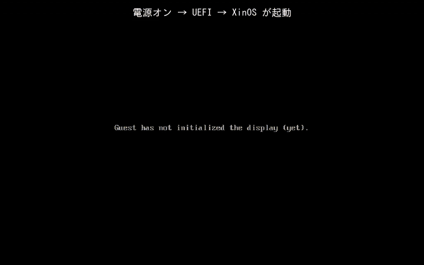

# XinOS



MikanOS をベースにした x86-64 UEFI OS。

## 目標
- シェル拡張(help / ver / uptime / uname など)
- 永続ディスク、ディレクトリ
- テキストエディタ
- 簡易アセンブリ言語 `xasm` と、その上の簡易高水準言語
- 標準プログラムの充実
- デスクトップ、スタートメニュー、アプリ配置

## ベース
MikanOS (https://github.com/uchan-nos/mikanos) を元にしています。ライセンスは LICENSE / NOTICE を参照。

## ビルド

必要なもの: `clang` `lld` `nasm` `mtools` `xorriso` `fdisk`(sfdisk) `python3` `build-essential` `uuid-dev` `acpica-tools`
(起動確認には `qemu-system-x86` と `ovmf`)

1. MikanOS用のx86_64-elf環境(newlib / libc++ / freetype)を展開する
   (https://github.com/uchan-nos/mikanos-build の `x86_64-elf.tar.gz`)
2. edk2 を取得し、`make -C BaseTools` でBaseToolsをビルドする
3. 環境変数を設定してビルドする

```sh
export XINOS_ELF_DIR=$HOME/osbook/x86_64-elf   # 手順1の展開先
export XINOS_EDK2=$HOME/edk2                   # 手順2のedk2
scripts/build-loader.sh   # build/Loader.efi
scripts/build-os.sh       # kernel/kernel.elf と apps/*
scripts/mkiso.sh          # build/xinos.iso
scripts/mkdisk.sh [MiB]   # 永続ディスク build/disk.img を作成(既存なら中身を消さずにシステムファイルだけ更新)
scripts/run.sh            # QEMU (UEFI) で起動(build/disk.img があれば自動で接続)
```

## 永続ディスク
ボリュームラベルが `XINOSDISK` のFAT32ボリュームが見つかると、それがルートとして使われ、
ファイルの変更は再起動後も残ります(見つからない場合はISO内のRAMボリュームで、変更は消えます)。
- 対応ストレージ: **NVMe** / **SATA(AHCI)** / **USBメモリ(Mass Storage)** / virtio-blk(QEMU用)。ディスク全体、GPT、MBR のパーティションを探します
- 論理セクタは 512 バイトと 4096 バイト(4Kn NVMe)に対応(SATA は論理512バイトのみ)
- **安全のため、ラベルが `XINOSDISK` でないボリュームには一切書き込みません**(他OSのディスクは読み取りもしません)
- コマンドの終了ごと、および `reboot` / `poweroff` 時に変更ブロックだけをディスクへ書き戻します
- `sync`: 手動で書き戻す / `disk`: マウント元(デバイス名・パーティション位置)を表示
- ボリュームは起動時に全体をRAMへ読み込むため、最大 256MiB です

### QEMU で試す
```sh
scripts/mkdisk.sh 64                  # build/disk.img を作成(既存なら中身を消さずにシステムファイルだけ更新)
XINOS_DISK_BUS=nvme scripts/run.sh    # virtio(既定) / nvme / ahci / usb を選べる
```

## 実機で使う (x64 UEFI)
`scripts/mkinstall.sh [データ領域MiB]` で、GPT付きのディスクイメージ `build/xinos-install.img` を作ります
(EFIシステムパーティション80MiB + ラベル `XINOSDISK` の永続領域。既定192MiB、最大256MiB)。
```sh
scripts/mkinstall.sh 192
scripts/run-disk.sh nvme              # QEMU で、このイメージをディスクとして直接起動して確認(nvme / ahci / virtio / usb)
# 実機へ: 書き込み先を lsblk などで必ず確認すること(そのディスクの内容は全て消えます)
sudo dd if=build/xinos-install.img of=/dev/<対象ディスク> bs=4M conv=fsync status=progress
```
- 書き込み後、UEFI(BIOS)の設定で **Secure Boot を無効** にして、そのディスクから起動してください(ローダは署名されていません)
- イメージはディスクより小さいため、GPTのバックアップヘッダはイメージ末尾にあります。UEFIが警告する場合は `gdisk` の `w` などで修復できます
- ISO(`xinos.iso`)をUSBメモリに `dd` して起動すると、永続化なしのRAMモードで試せます。内蔵のNVMe/SATAに `XINOSDISK` があれば、そちらが使われます
- **QEMUでのみ動作確認しています。実機での動作は未確認です。**
- 制限: ストレージは NVMe・SATA(AHCI)・USBメモリのみ(SDカード、RAIDモードのSATA、4Kn のUSBメモリは未対応)。USBメモリは起動後に認識するため、起動時に最大約2.5秒待ちます。
  キーボード/マウスは **xHCI(USB3)のUSB機器** のみです。ノートPC内蔵のPS/2キーボードは動かないため、USBキーボードを使ってください

## 起動画面
黒背景に金色の大きな「XinOS」と、Windows XP 風の進捗バー(青いブロックが流れる)を、約5秒表示します(`kernel/splash.cpp`)。

## デスクトップ
- 左下の「XinOS」ボタンでスタートメニュー、デスクトップのアイコンはダブルクリックで起動します
- アイコンとメニューは、ボリューム上のファイルから**動的に**作られます。アプリごとにアイコンを設定できます
  - `/desktop/*.LNK` … デスクトップのショートカット / `/startmenu/*.LNK` … スタートメニューの項目
  - `/icons/*.XIC` … アイコン画像(`"XIC1"` + 幅 + 高さ + 32bit ARGB。生成は `tools/mkicons.py`)
  - LNK は `key=value` のテキスト: `name=` `exec=` `icon=` `terminal=0|1` `cwd=` `special=trash`
- シェルから設定: `link [-s] [-t] <表示名> <アイコン.XIC | -> <コマンド...>`(`-s` でスタートメニュー、`-t` で端末ウィンドウ付き)、`unlink [-s] <表示名>`
  - 例: `link MyEdit /icons/EDITOR.XIC tedit`
- **ゴミ箱**: デスクトップのゴミ箱アイコンは、中身があると見た目が変わります。`trash <パス>` で移動、`restore <名前>` で元の場所へ戻す、`emptytrash` で空にします
- **ファイルマネージャ `filer`**(デスクトップの「Files」): フォルダ移動、新しいフォルダ、名前変更、ゴミ箱へ移動、復元、完全削除、ファイルのダブルクリック実行(`.XH` `.XA` `.JPG` など)

## 標準プログラム
- シェル組み込み: `help` `ver` `uname` `uptime` `echo` `clear` `ls` `cat` `date` `memstat` `cd` `pwd` `mkdir` `rmdir` `rm` `touch` `mv` `sync` `disk` ほか
- `xasm <file.xa>`: 簡易アセンブラ+VM(命令は `apps/xasm/xvm.hpp` 参照、サンプル `hello.xa`)
- `xhl [-S] <file.xh>`: 簡易高水準言語。xasmへコンパイルして実行(`-S` で生成コードを表示)
  - 入出力はC風: `printf("x=%d %c %s\n", x, 65, "str");`(`%d` `%c` `%s`(文字列リテラル) `%%`)、
    `scanf("%d", &x);`(`%d` `%c` と空白。読めた個数を返し、EOFなら `EOF`(-1)。Ctrl+DでEOF)
  - サンプルは `/samples` にあります: `hello.xh` `demo.xh` `primes.xh` `input.xh`(`hello.xa` は xasm 用)
- `wc` `head` `tail`: ファイル/標準入力(パイプ可)を処理
- `filer [ディレクトリ]`: ファイルマネージャ(GUI)
- そのほかMikanOS由来: `tedit` `paint` `gview` `blocks` `cube` `grep` `sort` `more` `cp` など

## ディレクトリ
- ルート直下: `/apps`(アプリ) `/home`(ユーザー用) `/samples`(サンプル) とリソースファイル
- プロンプトにカレントディレクトリを表示(`/home>` など)。相対パス・`.`・`..` が使えます
- アプリからの `fopen` も、実行したターミナルのカレントディレクトリ基準で解決されます
- ファイル名は 8.3 形式(例: `report.txt`、ディレクトリ名は8文字まで)。`mv` は既存ディレクトリを指定するとその中へ移動します

## デモ動画
約5分のツアー動画は `scripts/record-tour.py`(起動画面 → デスクトップ → ファイルマネージャ → ターミナル → 再起動後も残る永続ディスク)で撮れます。
上のGIFは `docs/demo.gif` です。`scripts/record-demo.py [出力.mp4] [メニュー番号]` で、電源オン → UEFI起動 → デスクトップ → スタートメニュー → アプリ起動までを
QEMU上で自動操作して mp4 に録画します(要 `ffmpeg`、事前に `scripts/mkiso.sh`)。メニュー番号は 0=Terminal 1=Editor 2=Paint 3=Viewer 4=Blocks 5=Cube(既定) 6=Eye 7=Stars。

## 今後の予定
- テキストエディタの強化、ウィンドウ付きファイルマネージャ
